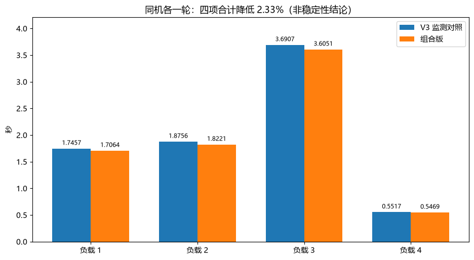

# 先导杯 ProGen2 DCU 优化

更新：2026-11-03。公开记录、源码与图表已按实测整理；最终参赛版本尚未冻结。

- [全部实验可视化](visualizations/20261103/README.md)：20轮有成绩记录，包含诊断和一致性未通过的实验。
- [本轮结果与复现](experiments/EXP-20261103-01.md)：V1、V2失败、V2b、V3及组合版。
- [当前分工](docs/TEAM.md) · [任务状态](docs/BOARD.md) · [优化路线](docs/OPTIMIZATION_PLAN.md)



组合版与V3监测对照的四项公开输出均100%一致；合计耗时7.6804秒与7.8636秒，本轮减少2.33%。两版各一轮，尚不能认定稳定收益；合计不是官方评分。编译监测范围内，正式调用均无Dynamo新编译事件。

## 代码入口

在已有官方模型资产和测试工具的DCU比赛目录中，分别运行：
```bash
bash candidates/fp32_step_gemm_v23/run_test.sh
bash candidates/fp32_gemm_tune_v3_audit/run_test.sh
```
这两个目录保存实测组合版和对照版。每次脚本建立独立结果目录；不覆盖官方基准、测试器或既有成绩。源码沿用官方模型及队友前期优化，来源与AI协助见[贡献说明](docs/CONTRIBUTIONS.md)。

`submission/`保持此前合入的入口，本轮未将候选替换为最终作品。根目录`solution.py`是V4实验副本，不代表已通过一致性验证的默认方案；该配置的结果见本轮记录。

## 协作与交付

WYBCOOPER负责DCU测试、测量、归档，并参与优化；loveviolet2、JIYIA718-ai主要负责优化。历史A/B/C为早期建议标记，当前以账号分工为准。合并归档不代表队友已独立复核或最终验收。

[实验依据](records/README.md) · [实验规范](docs/EXPERIMENTS.md) · [个人记录](members/WYBCOOPER.md) · [提交检查](docs/RELEASE.md)

保留既有北京时间22:00交付、23:00审查节点，按[逐日计划](docs/SCHEDULE.md)执行；实际延期照实记录。GitHub更新不代表比赛作品已发送。
